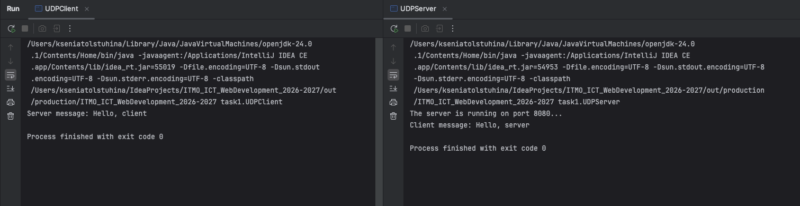

# Задание 1 - Обмен сообщениями по UDP

### Задача

Клиент отправляет серверу `Hello, server`, сервер выводит это сообщение и отвечает `Hello, client`, которое выводится у клиента. Протокол — UDP

### Теория

UDP - протокол без установления соединения. Отправитель просто посылает датаграмму, не дожидаясь подтверждения. Это быстрее TCP, но не гарантирует ни доставку, ни порядок пакетов

В Java работа с UDP — это `DatagramSocket`, `DatagramPacket`, `InetAddress`

### Код сервера
```java
package task1;

import java.net.*;

public class UDPServer {
  public static void main(String[] args) throws Exception {
    int PORT = 8080;

    DatagramSocket socket = new DatagramSocket(PORT);
    System.out.println("The server is running on port 8080...");
    byte[] buffer = new byte[1024];

    DatagramPacket packet = new DatagramPacket(buffer, buffer.length);
    socket.receive(packet);
    String clientMsg = new String(packet.getData(), 0, packet.getLength(), "UTF-8");
    System.out.println("Client message: " + clientMsg);

    String response = "Hello, client";
    byte[] encodedResponse = response.getBytes("UTF-8");
    DatagramPacket responsePacket = new DatagramPacket(encodedResponse, encodedResponse.length, packet.getAddress(), packet.getPort());
    socket.send(responsePacket);

    socket.close();
  }
}
```

### Код клиента 
````java
package task1;

import java.net.*;

public class UDPClient {
  public static void main(String[] args) throws Exception {
    String HOST = "localhost";
    int PORT = 8080;

    DatagramSocket socket = new DatagramSocket();
    InetAddress serverAddress = InetAddress.getByName(HOST);

    String request = "Hello, server";
    byte[] encodedRequest = request.getBytes("UTF-8");
    DatagramPacket requestPacket = new DatagramPacket(encodedRequest, encodedRequest.length, serverAddress, PORT);
    socket.send(requestPacket);

    byte[] buffer = new byte[1024];
    DatagramPacket packet = new DatagramPacket(buffer, buffer.length);
    socket.receive(packet);
    String serverMsg = new String(packet.getData(), 0, packet.getLength(), "UTF-8");
    System.out.println("Server message: " + serverMsg);

    socket.close();
  }
}
````

### Запуск
```
javac -d out src/task1/UDPServer.java src/task1/UDPClient.java

# Терминал 1
java -cp out task1.UDPServer

# Терминал 2
java -cp out task1.UDPClient
```

### Пример 


