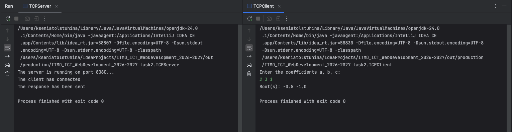

# Задание 2 - Вычисления через TCP

### Задача
Клиент вводит коэффициенты `a`, `b`, `c` квадратного уравнения. Сервер считает корни и возвращает результат. Протокол — TCP

### Теория
TCP, в отличие от UDP, требует установления соединения и гарантирует доставку и порядок байт

В Java для сервера используется `ServerSocket`, для клиента — `Socket`. Метод `accept()` на сервере блокируется, пока клиент не подключится, и возвращает новый сокет для общения именно с этим клиентом

### Код сервера
```java
package task2;

import java.io.*;
import java.net.ServerSocket;
import java.net.Socket;

public class TCPServer {
  public static void main(String[] args) throws IOException {
    int PORT = 8080;

    ServerSocket socket = new ServerSocket(PORT);
    System.out.println("The server is running on port 8080...");

    Socket clientSocket = socket.accept();
    System.out.println("The client has connected");

    BufferedReader input = new BufferedReader(new InputStreamReader(clientSocket.getInputStream(), "UTF-8"));
    PrintWriter output = new PrintWriter(new OutputStreamWriter(clientSocket.getOutputStream(), "UTF-8"), true);

    double a = Double.parseDouble(input.readLine());
    double b = Double.parseDouble(input.readLine());
    double c = Double.parseDouble(input.readLine());

    double discriminant = b * b - 4 * a * c;
    if (discriminant > 0){
      double x1 = (-b + Math.sqrt(discriminant)) / (2 * a);
      double x2 = (-b - Math.sqrt(discriminant)) / (2 * a);
      output.println(x1 + " " + x2);
    } else if (discriminant == 0) {
      double x = -b / (2 * a);
      output.println(x);
    } else {
      output.println("no roots");
    }
    System.out.println("The response has been sent");
    clientSocket.close();
    socket.close();
  }
}
```
### Код клиента 
```java
package task2;

import java.io.*;
import java.net.Socket;
import java.util.Scanner;

public class TCPClient {
  public static void main(String[] args) throws IOException {
    String HOST = "localhost";
    int PORT = 8080;

    Socket socket = new Socket(HOST, PORT);

    BufferedReader input = new BufferedReader(new InputStreamReader(socket.getInputStream(), "UTF-8"));
    PrintWriter output = new PrintWriter(new OutputStreamWriter(socket.getOutputStream(), "UTF-8"), true);

    Scanner sc = new Scanner(System.in);
    System.out.println("Enter the coefficients a, b, c: ");
    double a = sc.nextDouble();
    double b = sc.nextDouble();
    double c = sc.nextDouble();

    output.println(a);
    output.println(b);
    output.println(c);

    String result = input.readLine();
    System.out.println("Root(s): " + result);

    socket.close();
  }
}
```
### Запуск
```
# Терминал 1
java -cp out task2.TCPServer

# Терминал 2
java -cp out task2.TCPClient
```

### Пример 
