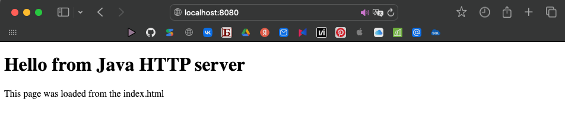

# Задание 3 - Раздача HTML-страницы по HTTP

### Задача
Серверная часть приложения: клиент подключается к серверу, сервер отдаёт HTTP-сообщение с HTML-страницей, загруженной из файла `index.html`

### Теория
HTTP-ответ — обычный текст по строгому формату: строка статуса, заголовки, пустая строка, тело

### Код сервера
```java
package task3;

import java.io.BufferedReader;
import java.io.IOException;
import java.io.InputStreamReader;
import java.io.OutputStream;
import java.net.ServerSocket;
import java.net.Socket;
import java.nio.file.Files;
import java.nio.file.Path;

public class HTTPServer {
  public static void main(String[] args) throws IOException {
    int PORT = 8080;

    ServerSocket serverSocket = new ServerSocket(PORT);
    System.out.println("HTTP server at http://localhost:8080");

    while (true){
      Socket clientSocket = serverSocket.accept();

      BufferedReader input = new BufferedReader(new InputStreamReader(clientSocket.getInputStream(), "UTF-8"));
      String request = input.readLine();
      System.out.println("Request: " + request);

      byte[] body = Files.readAllBytes(Path.of("students/k3339/Tolstukhina_Ksenia/Lr1/src/task3/index.html"));

      String response =
        "HTTP/1.1 200 OK\r\n" +
        "Content-Type: text/html; charset=UTF-8\r\n" +
        "Content-Length: " + body.length + "\r\n" +
        "Connection: close\r\n" +
        "\r\n";

      OutputStream output = clientSocket.getOutputStream();
      output.write(response.getBytes("UTF-8"));
      output.write(body);
      output.flush();

      clientSocket.close();
    }
  }
}
```
### HTML-страница `index.html`
```html
<!DOCTYPE html>
<html lang="en">
<head>
    <meta charset="UTF-8">
    <title>Laboratory work</title>
</head>
<body>
    <h1>Hello from Java HTTP server</h1>
    <p>This page was loaded from the index.html</p>
</body>
</html>
```
### Запуск
`java -cp out task3.HTTPServer`

И открыть в браузере `http://localhost:8080`

### Пример 
