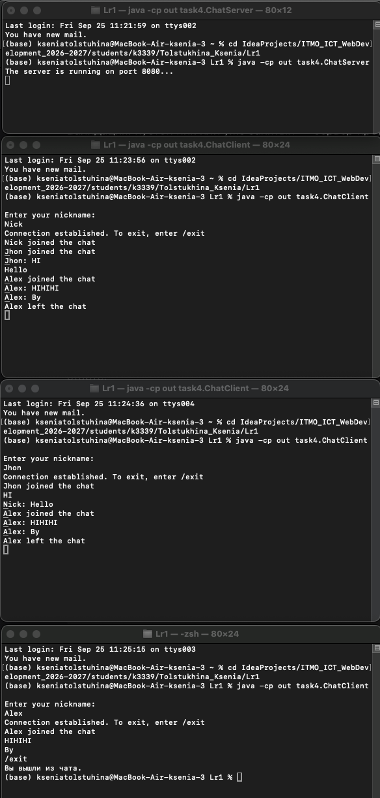

# Задание 4 - Чат на сокетах

### Задача
Реализовать многопользовательский чат на TCP. Требования:  
- обслуживание нескольких клиентов;  
- идентификация пользователей;  
- возможность выйти из чата;  
- один клиентский скрипт, запускаемый несколько раз

### Теория
Сервер держит список активных подключений и рассылает входящие сообщения всем. Каждое соединение обслуживается отдельным потоком. В Java потоки — через `ExecutorService` или `Thread`, список клиентов — `ConcurrentHashMap`

### Код сервера
```java
package task4;

import java.io.*;
import java.net.ServerSocket;
import java.net.Socket;
import java.util.concurrent.ConcurrentHashMap;

public class ChatServer {
  private static final int PORT = 8080;
  private static final ConcurrentHashMap<String, ClientHandler> clients = new ConcurrentHashMap<>();

  public static void main(String[] args) throws IOException {
    new ChatServer().start(PORT);
  }

  public void start(int port) throws IOException {
    try (ServerSocket serverSocket = new ServerSocket(port)){
      System.out.println("The server is running on port 8080...");

      while (true) {
        Socket clientSocket = serverSocket.accept();
        ClientHandler handler = new ClientHandler(clientSocket);
        new Thread(handler).start();
      }
    }
  }

  private void broadcast(String message, String nickName) {
    for (ClientHandler client : clients.values()) {
      if (!client.nickName.equals(nickName)) client.send(message);
    }
  }

  private void broadcastSystem(String message) {
    for (ClientHandler client : clients.values()) client.send(message);
  }

  private class ClientHandler implements Runnable {
    private final Socket clientSocket;
    private BufferedReader input;
    private PrintWriter output;
    private String nickName;

    ClientHandler(Socket socket) {
      this.clientSocket = socket;
    }

    @Override
    public void run() {
      try {
        input = new BufferedReader(new InputStreamReader(clientSocket.getInputStream(), "UTF-8"));
        output = new PrintWriter(new OutputStreamWriter(clientSocket.getOutputStream(), "UTF-8"), true);

        if (!registerUser()) return;

        broadcastSystem(nickName + " joined the chat");

        String line;
        while ((line = input.readLine()) != null) {
          if (line.equalsIgnoreCase("/exit")) break;
          else if (line.trim().isEmpty()) continue;
          else broadcast(nickName + ": " + line, nickName);
        }
      } catch (IOException e) {
        System.out.println("Connection to " + safeName() + " has been interrupted: " + e.getMessage());
      } finally {
        disconnect();
      }
    }

    private boolean registerUser() throws IOException {
      output.println("Enter your nickname:");
      while (true) {
        String name = input.readLine();
        if (name == null) return false;
        name = name.trim();
        if (name.isEmpty()) {
          output.println("The name cannot be empty. Please try again:");
          continue;
        }
        if (clients.containsKey(name)) {
          output.println("This name is already taken. Enter another:");
          continue;
        }
        nickName = name;
        clients.put(nickName, this);
        output.println("OK");
        return true;
      }
    }

    void send(String message) {
      output.println(message);
    }

    private String safeName() {
      return nickName != null ? nickName : "unknown";
    }

    private void disconnect() {
      if (nickName != null) {
        clients.remove(nickName);
        broadcastSystem(nickName + " left the chat");
      }
      try {
        clientSocket.close();
      } catch (IOException ignored) { }
    }
  }
}
```
### Код клиента
```java
package task4;

import java.io.*;
import java.net.Socket;

public class ChatClient {
  public static void main(String[] args) throws IOException {
    String HOST = "localhost";
    int PORT = 8080;

    Socket socket = new Socket(HOST, PORT);
    BufferedReader input = new BufferedReader(new InputStreamReader(socket.getInputStream(), "UTF-8"));
    PrintWriter output = new PrintWriter(new OutputStreamWriter(socket.getOutputStream(), "UTF-8"), true);
    BufferedReader console = new BufferedReader(new InputStreamReader(System.in, "UTF-8"));

    System.out.println(input.readLine());
    String response;
    do {
      String nickName = console.readLine();
      output.println(nickName);
      response = input.readLine();
      if (response == null) {
        System.out.println("The server closed the connection");
        return;
      }
      if (!response.equals("OK")) System.out.println(response);
    } while (!response.equals("OK"));

    System.out.println("Connection established. To exit, enter /exit");

    Thread readerThread = new Thread(() -> {
      try {
        String message;
        while ((message = input.readLine()) != null) System.out.println(message);
      } catch (IOException e) {
        System.out.println("The connection is closed");
      }
    });
    readerThread.setDaemon(true);
    readerThread.start();

    String userInput;
    while ((userInput = console.readLine()) != null) {
      if (userInput.trim().isEmpty()) continue;
      output.println(userInput);
      if (userInput.equalsIgnoreCase("/exit")) break;
    }
    System.out.println("You have left the chat");
    socket.close();
  }
}

```

### Запуск
```
# Терминал 1
java -cp out task4.ChatServer

# Терминал 2
java -cp out task4.ChatClient

# Терминал 3
java -cp out task4.ChatClient

# Терминал 4
java -cp out task4.ChatClient

```
### Пример 
